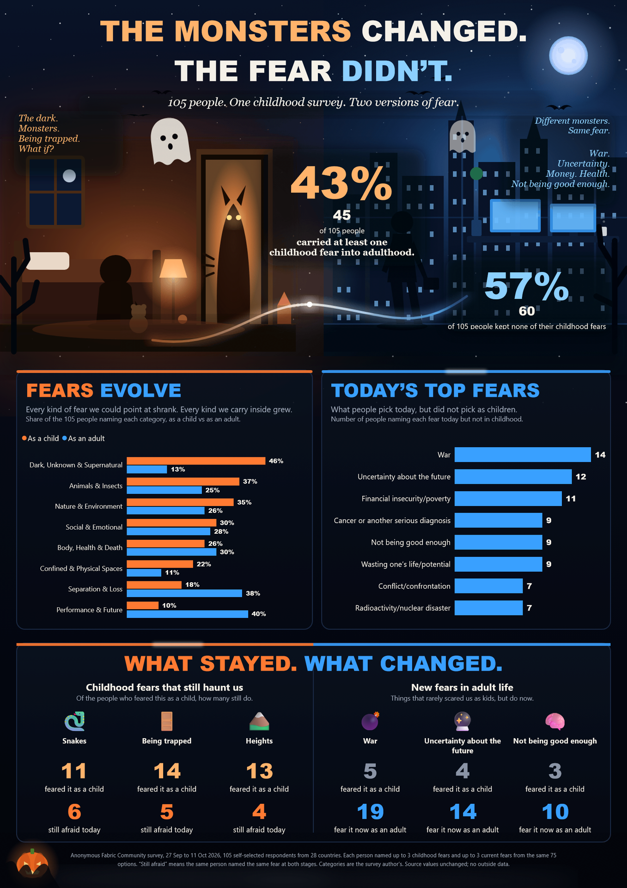

# The Monsters Changed. The Fear Didn't.

> 🎃 Halloween DataViz Contest 2026 — Fabric Community × Power BI

[](#the-poster)

One portrait Power BI page (1357 × 1920) built on the organizer's starter model, with an animated bedroom-to-office scene.

**📌 [Contest Submission — Fabric Community](https://community.fabric.microsoft.com/discussions/pbi_contestsgallery/the-monsters-changed-the-fear-didnt-/5375310)**

**💼 [LinkedIn Post](https://www.linkedin.com/feed/update/urn:li:activity:7517247410939801601/)**

**📂 [GitHub Repository](https://github.com/oii-nasif/the-monsters-changed-powerbi)**

---

## The Insight

105 people told the Fabric Community what scared them as kids and what scares them now.

- **43%** still carry at least one childhood fear; **57%** left them all behind
- "Dark, unknown & supernatural" fears fall from **46%** of people to **13%**
- "Performance & future" rises from **10%** to **40%**
- **War** is now the most common adult fear — named by 19 people, up from 5
- Some monsters never leave: **6 of 11** people who feared snakes as children still do

> As children, we feared what we could see. As adults, we fear what we can't.

---

## The Poster

The page walks from a child's bedroom to an adult's office. The scene moves — the ghost drifts, the lamp and the monster's eyes flicker, office windows switch on and off, and a light travels from the bedroom to the office.


Everything is native Power BI on the organizer's starter model:
- Every number is a **live measure** — nothing is typed in
- The illustration is a **custom SVG**
- Motion comes from **looping GIFs** in native image visuals
- No custom visuals, no external data

---

## Repository Structure

```
├── build/
│   ├── The Monsters Changed - Live.pbix   # The animated entry
│   ├── The Monsters Changed.pbix          # Static fallback (no animation)
│   ├── The Monsters Changed - Live.pdf    # PDF export
│   ├── monsters-changed-poster.png        # Full-page poster (1357 × 1920)
│   ├── monsters-changed-video.mp4         # 15s video for LinkedIn
│   ├── monsters-changed.gif               # Looping GIF for README/Slack/Teams
│   ├── live/                              # GIF regions + manifest
│   └── video/                             # Video composite inputs
├── art/
│   ├── poster_bg.html                     # Static SVG scene (source of truth)
│   ├── live_script.js                     # Animation timeline & GIF regions
│   ├── poster_live.html                   # Generated: scene + animation
│   └── anim.html                          # Storyboard for LinkedIn video
├── data/
│   ├── Halloween Contest 2026 - Starter File.pbix
│   └── survey_responses.csv               # Raw CSV from organizers
├── scripts/
│   ├── build_poster_v2.js                 # Generates poster page as PBIR JSON
│   ├── build_gifs.js                      # Renders GIF regions via headless Chrome + ffmpeg
│   ├── make_live_html.js                  # Injects animation into static SVG
│   ├── render_page_frames.js              # Full-page frame renderer (video pipeline)
│   ├── zipdir.js                          # Repacks folder into .pbix
│   ├── add_measures_tom.ps1               # Adds measures via TOM scripting
│   ├── query_model.ps1                    # DAX/DMV queries against live Desktop
│   ├── export_pdf_live.ps1                # Drives File > Export > PDF in Desktop
│   ├── pdf2png.ps1                        # PDF page 1 → PNG
│   └── dax/                               # DAX queries for model profiling
├── BRIEF.md                               # Contest rules & accessibility checklist
├── BUILD_PLAN.md                          # Design notes & story numbers
├── SUBMISSION.md                          # Contest gallery post text
├── LINKEDIN.md                            # LinkedIn post caption & video pipeline
└── analysis_output.txt                    # Data analysis output
```

---

## How the Animation Works

1. `art/live_script.js` defines `window.TOTAL` (loop length) and `window.REGIONS` (page rectangles). Every motion is periodic in `TOTAL`, so each GIF loops seamlessly.
2. `scripts/build_gifs.js` screenshots each region for every frame (10 fps) and encodes with ffmpeg — unchanged pixels stay identical between frames.
3. The page background is the t=0 frame, so GIF rectangles match the static image behind them.
4. The builder adds one native image visual per region before the data cards, so data visuals render on top.
5. Regions must not overlap. The moving light crosses between GIFs that share the same loop length.

---

## Regenerate the .pbix

```bash
# 1. Extract the model with extra measures
mkdir -p /tmp/base_peek && cd /tmp/base_peek && unzip -o -q "build/base_measures2.pbix"

# 2. Scene → animated HTML → GIFs + background PNG
node scripts/make_live_html.js art/poster_bg.html art/live_script.js art/poster_live.html
NODE_PATH="$TEMP/anim/node_modules" node scripts/build_gifs.js art/poster_live.html build/live 10

# 3. Build the page and repack
cd scripts
GIFS=../build/live/manifest.json node build_poster_v2.js /tmp/base_peek ../build/pbix_live ../build/live/poster_bg.png
node zipdir.js ../build/pbix_live "../build/The Monsters Changed - Live.pbix"

# Static fallback (no GIFs)
node build_poster_v2.js /tmp/base_peek ../build/pbix_v2 ../art/poster_bg.png
node zipdir.js ../build/pbix_v2 "../build/The Monsters Changed.pbix"
```

> **Prerequisites:** Node.js, puppeteer-core, ffmpeg, Power BI Desktop

---

## Colours & Accessibility

| Role | Hex | Usage |
|---|---|---|
| Childhood / warm | `#FF7A32` / `#FFB36B` | Orange tones |
| Adulthood / cool | `#39A0FF` / `#8CD0FF` | Blue tones |
| Ink / text | `#F5F1E8` | On `#05070D` background |

- Orange vs blue passes colour-vision-deficiency checks
- All pairs exceed **3:1 contrast** on the dark background
- Every bar and card carries a visible value — no colour-only encoding
- Tab order follows the story; decorative animations excluded
- Alt text on every data visual describes the insight

---

## Model Objects

**From the starter model:**
`FactFearSelection[LifeStage]`, `[IsRetained]`, `DimFear[Fear]`, `DimFear[Category]`, measures `Number of Respondents`, `Childhood-Only Fear Selections`, `Adult-Only Fear Selections`

**Added measures (in `_Measures`):**
`People Keeping A Childhood Fear`, `People Keeping None`, `Pct Keeping A Childhood Fear`, `Pct Keeping None`, `Childhood Selections`, `Adult Selections`, `Still Afraid`, `Pct of People`, `Pct of People Childhood`, `Pct of People Adult`, `Adult-Only Fear Selections` (per fear)

---

## Honesty Notes

- Each person named up to three fears per life stage — category shares are "share of people naming at least one fear in that category"
- Categories are the survey author's grouping
- Respondents are self-selected and skew male, aged 25–44
- Source values unchanged, no outside data

---

## Credits

Contest organized by [Karin Szilágyi](https://www.linkedin.com/in/karinszilagyi/) and the [Fabric Community](https://community.fabric.microsoft.com/) team.

---

## License

The survey data belongs to the contest organizers. The code and illustration in this repo are my own work, shared for learning.
